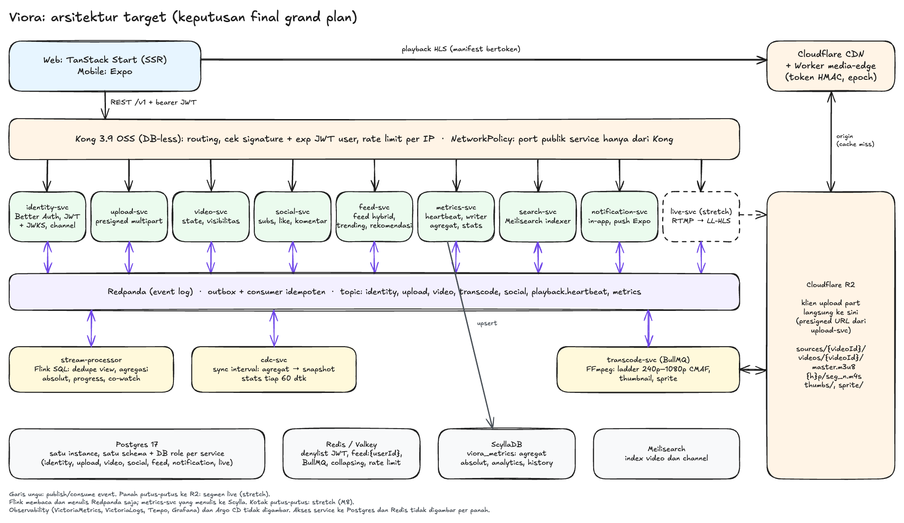

# viora

Platform video mirip YouTube yang dibangun sebagai portofolio system design: upload, transcode ke HLS, playback lewat CDN, feed subscription, dan pipeline metrics. Semua jalan sebagai microservice TypeScript di Bun, dengan event lewat Redpanda.

Rencana lengkapnya ada di [docs/grand-plan.md](docs/grand-plan.md): scope, NFR, data model, kontrak event, API, infra, dan roadmap M0 sampai M9.



## Status

Milestone M0 (fondasi) sedang berjalan. Yang sudah ada di repo:

| Bagian | Isi | Bukti |
|---|---|---|
| Monorepo | Bun workspaces + Turborepo, 11 skeleton service dari `bun run new:service` | `turbo run typecheck` |
| `packages/contracts` | Envelope event (Zod), nama topic, skema data event identity | dipakai test identity-svc |
| `packages/service-kit` | Relay outbox (advisory lock, filter xmin), consumer dengan retry bertahap dan DLQ, `processOnce`, verifikasi JWT user dan denylist | `packages/service-kit/test`, termasuk test balapan consumer utama vs retry |
| `apps/identity-svc` | Better Auth dengan Drizzle, keyring ES256, trigger outbox identity, `GET` dan `DELETE /v1/me` | `apps/identity-svc/test` |
| `spikes/` | `@platformatic/kafka` di Bun, keyring Better Auth + plugin `jwt` Kong 3.9 | `spikes/*/` |

Hasil spike, temuan yang mengubah rencana, dan hal yang belum dibuktikan dicatat di §18A grand plan. Yang belum ada: generator konfigurasi Kong, `apps/web`, `apps/mobile`, dan semua service selain identity.

## Stack

- Runtime dan tooling: Bun 1.4, Turborepo, TypeScript 7, oxlint
- Service: Hono, Drizzle ORM, Better Auth, Zod
- Data dan event: Postgres 17, Redpanda, Redis
- Gateway: Kong 3.9 OSS (DB-less)
- Rencana berikutnya: FFmpeg + BullMQ untuk transcode, Cloudflare R2 dan Workers untuk media, Flink SQL dan ScyllaDB untuk metrics, Meilisearch, TanStack Start untuk web, Expo untuk mobile, k3s dengan Argo CD

## Struktur

```
apps/        service (identity-svc, upload-svc, ...), nanti web dan mobile
packages/    contracts, service-kit, config
infra/       compose (dev lokal), kong, keys (public key dev)
spikes/      eksperimen M0 yang hasilnya menentukan keputusan desain
tools/       scaffolder service
docs/        grand plan, verifikasi klaim, flow lo-fi, diagram
```

## Menjalankan lokal

Butuh Bun 1.4.4 dan Docker. Semua port host digeser +10000 dari default supaya tidak bentrok dengan proyek lain: Postgres 15432, Redis 16379, Redpanda 19092, Kong 18000 (proxy) dan 18001 (admin), service 13001 sampai 13011.

```bash
bun install
bun run dev:infra
```

Menyiapkan identity-svc:

```bash
cd apps/identity-svc
cp .env.example .env
bun run keys:dev
bun run db:migrate
docker exec viora-redpanda-1 rpk topic create identity.v1 -p 3
bun run dev
```

Isi `AUTH_SECRET` di `.env` dengan hasil `openssl rand -base64 48`. Service menolak start kalau nilainya masih contoh. `keys:dev` membuat keypair ES256 di `infra/keys/dev`. Private key-nya diabaikan git, dan lingkungan selain dev memakai kunci dari SOPS.

Selama penyedia email belum dipilih, email verifikasi dan reset password ditulis ke log service.

## Test

Test integrasi memakai Postgres, Redis, dan Redpanda asli, jadi infra harus menyala.

```bash
bunx turbo run typecheck
bunx oxlint .
cd packages/service-kit && bun test --timeout 60000
cd apps/identity-svc && bun test --timeout 60000
```

Test identity-svc membuat database baru di setiap run dan menghapusnya setelah selesai.

## Dokumen

- [docs/grand-plan.md](docs/grand-plan.md): rencana utama dan riwayat revisi
- [docs/verification.md](docs/verification.md): verifikasi klaim teknis komunikasi antar-service beserta sumbernya
- [docs/flows](docs/flows/README.md): 20 flow end-to-end dalam wireframe lo-fi Excalidraw

## Lisensi

[MIT](LICENSE)
